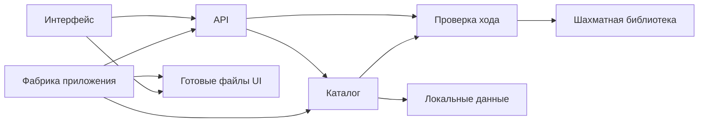
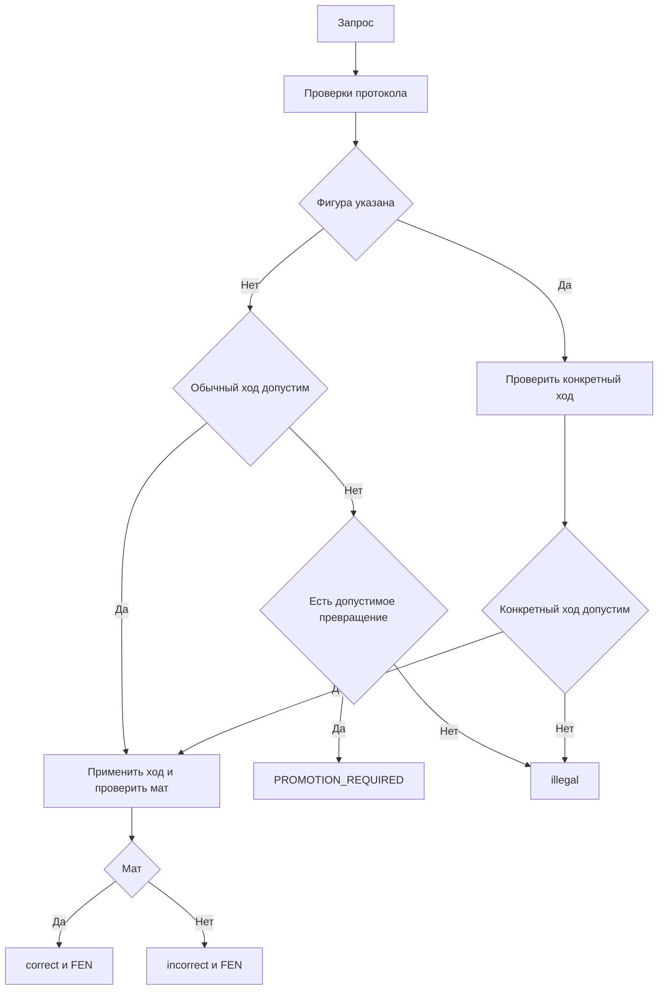

# Технический дизайн: mate-in-one-backend

## Обзор (Overview)

Backend тренажёра выдаёт пять учебных позиций и независимо проверяет попытки пользователей. Источник внешнего контракта — [mate-in-one-api.md](../../contracts/mate-in-one-api.md), включая исправленный порядок проверки превращения в разделе 6. Требования утверждены пользователем 28 октября 2026 года; утверждение записано в spec.json. Сохранившиеся в requirements.md формулировки «на проверке» относятся к состоянию до этого утверждения и не отменяют текущую запись согласования.

Статус этого документа: **дизайн сформирован для проверки, ещё не утверждён**. Текущая работа создаёт только документацию. Все перечисленные ниже исходники, данные и тесты — план будущей реализации, а не созданные файлы. [research.md](research.md) содержит источники и основания решений.

### Цели (Goals)

- Обеспечить точное выполнение всех 82 критериев требований и согласованного протокола.
- Сохранить шахматные правила на backend, независимо от UI и предыдущих попыток.
- Подготовить и проверить пять собственных учебных позиций в рамках будущей реализации backend, не оставляя поставщика данных скрытой предпосылкой.
- Предоставить другой команде API и обслуживание её готовых файлов с одного origin.

### Не входит в объём (Non-Goals)

Разработка интерфейса, подсветка ходов, регистрация, история, БД, Stockfish, полная партия, серверная навигация, отдельный CORS-сценарий. Численные SLA backend не установлены; клиентские десять секунд не становятся SLA.

## Обязательства границы (Boundary Commitments)

### Ответственность спецификации (This Spec Owns)

- Собственный локальный набор из пяти задач, его порядок, неизменяемое опубликованное представление и проверка пригодности.
- Допустимость, мат и необходимость уточнить превращение относительно исходного FEN.
- Три операции API и все прикладные ошибки в точном соответствии с общим контрактом.
- Фабрика Flask, обслуживающая API и переданные UI-файлы с одного origin, без изменения их поведения.
- Backend-проверки и интеграционные проверки внешнего обмена. Предусмотрена подготовка исходных учебных позиций вручную, без генератора задач в приложении.

### Вне границы (Out of Boundary)

mate-in-one-ui владеет HTML/CSS/JavaScript, доской, выбором клеток/фигуры, навигацией, десятисекундным ожиданием, ручными повторами и защитой от устаревших ответов. Backend не создаёт эти исходники и не реализует курсор, /next или локальный прогресс клиента.

### Разрешённые зависимости (Allowed Dependencies)

- Утверждённый общий контракт — совместная внешняя граница; дизайн не меняет его схемы, статусы или порядок ошибок.
- Python stdlib, Flask и библиотека python-chess через распространяемый пакет chess.
- Утверждённая поставка mate-in-one-ui находится в frontend: UI_ROOT указывает на этот каталог. Публичны только index.html через GET /, styles.css через /static/ui/styles.css и файлы js через /static/ui/js/.... frontend/tests и frontend/package.json не раздаются. API сохраняет /api/v1; исходники UI не переносятся в backend-компоненты.
- Шахматный компонент не импортирует Flask и не зависит от UI; загрузчик не зависит от обработчиков HTTP. Новые внешние сервисы и механизмы хранения не вводятся.

### Поводы повторной проверки (Revalidation Triggers)

Изменение JSON-схем, кодов/приоритета ошибок, превращения, смысла FEN или порядка/ID набора требует повторных контрактных тестов backend и совместных сценариев mate-in-one-ui. Изменение origin либо расположения UI-поставки требует проверки корневой страницы, ресурсов и относительных запросов. Обновление chess требует повторной проверки всех пяти позиций и специальных ходов; обновление Flask — 404/405, Content-Type и разбора JSON. Изменение готовности набора требует проверки приоритета 503 перед 404. Неизменность before-agreement обязательна.

## Архитектура (Architecture)

### Анализ существующего состояния

Проект пока состоит из документации и навыков; программных компонентов для расширения нет. Есть смежная спецификация mate-in-one-ui. Её требования изучены как интеграционная зависимость, но её файлы и статусы этим дизайном не изменяются. Общие product.md, tech.md и structure.md отсутствуют: применяются AGENTS.md, утверждённые требования и контракт без выдумывания дополнительных стандартов проекта.

### Архитектурный подход и границы

Небольшое локальное Flask-приложение с фабрикой. Каждый запрос обрабатывается обычным синхронным вызовом. Собственные потоки выполнения, фоновые задачи, очередь работ и асинхронный движок не создаются. Термин System Flows в шаблоне означает сценарии обработки, а не многопоточность. Собственные классы интерфейсов репозитория, ORM, DI-контейнер, шина событий и общий движок правил не нужны. Один файл отвечает за один существенный вид поведения; шахматные правила делегируются chess.

Допустимое направление импортов: **models → chess_service → dataset → http → фабрика приложения**; стрелка означает «следующий уровень может импортировать предыдущие». http может обращаться к models/chess_service напрямую; обратные импорты запрещены. Фабрика — единственная точка сборки, конфигурации и регистрации обработчиков. Библиотека chess допустима только в chess_service; dataset получает проверку пригодности через его публичный интерфейс. Сторонний Flask используется в http и фабрике. UI — потребитель протокола, не импортируемый Python-модуль.

### Стек (Technology Stack)

| Область | Выбор и версия | Назначение и ограничения |
| --- | --- | --- |
| Python | CPython 3.12–3.14 | Типы, stdlib json/unittest/pathlib/logging; доступный сейчас интерпретатор 3.14.6, выполнение приложения ещё не проверено |
| HTTP | Flask 3.1.3 | Фабрика приложения, маршруты, JSON, обслуживание файлов; requires Python >=3.9 |
| Шахматы | chess 1.11.2, библиотека python-chess | Допустимость и мат; requires Python >=3.8. Пакет python-chess 1.999 перенесён в chess |
| Данные | UTF-8 JSON, stdlib | Пять задач; загрузка при создании приложения, без горячей перезагрузки |
| Тесты | unittest из выбранного Python, Flask test_client | Без отдельного тестового фреймворка и без шахматного сервера |

Версии Flask и chess проверены по официальным страницам пакетов; на реализации они фиксируются в pyproject.toml. Указанные диапазоны Python — целевая конфигурация дизайна, не отчёт о пройденной матрице совместимости. В текущем окружении Flask и chess не установлены. При реализации требуется изолированное окружение; глобальные пакеты в этой работе не менялись.

## План файлов (File Structure Plan)

Все пути ниже относительны корню hw. Это план, **сейчас эти файлы не создаются**.

### Структура каталогов (Directory Structure)

| Будущий путь | Статус | Компонент и единственная ответственность |
| --- | --- | --- |
| pyproject.toml | Создать при реализации | Зависимости, Python, пакет и фиксированные версии |
| mate_trainer/models.py | Создать | DomainTypes: типизированные неизменяемые значения и объединения результатов |
| mate_trainer/chess_service.py | Создать | ChessEvaluator: пригодность позиции, законность и мат |
| mate_trainer/dataset.py | Создать | TaskCatalog: загрузка пяти задач и неизменяемый снимок доступности |
| mate_trainer/http.py | Создать | HttpApi: маршруты, входная валидация, сериализация и API-ошибки |
| mate_trainer/__init__.py | Создать | AppRuntime: фабрика, конфигурация, обработчики маршрутизации и раздача UI |
| data/tasks.json | Создать | Пять собственных исходных позиций в порядке каталога; без решений |
| tests/test_dataset.py | Создать | Проверка пригодности набора и ожидаемых отказов загрузки |
| tests/test_chess_service.py | Создать | Доменные сценарии допустимости, мата и превращения |
| tests/test_api.py | Создать | Контракт, схемы ответов и таблица приоритетов |
| tests/test_runtime.py | Создать | Готовность, изоляция попыток и обслуживание тестовой UI-поставки |
| tests/fixtures/positions.json | Создать | Дополнительные позиции для специальных правил и отрицательных примеров |
| tests/fixtures/task_cases.json | Создать | Ожидаемые решения и контрольные попытки для пяти задач; не публичный ресурс |
| docs/task-validation.md | Создать | Отчёт подготовки пяти позиций, все найденные маты и результаты проверок |
| docs/runbook.md | Создать | Установка, запуск, проверка, замена набора и подключение UI_ROOT |
| frontend/index.html, frontend/styles.css, frontend/js/ | Получить от mate-in-one-ui | UiHandoff: публичные файлы UI через точные маршруты; разработка и изменения не входят в backend |

### Изменяемые файлы (Modified Files)

Ранее существующих исходников backend нет. При текущем согласовании изменяются только design.md и research.md собственной спецификации. Метаданные spec.json, требования, brief, общий контракт, снимки before-agreement и документы mate-in-one-ui не редактируются. Пути frontend/* обозначают файлы UI-команды; backend не создаёт их вместо неё. Наличие frontend/tests и package.json рядом с публичными файлами не делает их доступными через HTTP.

## Сценарии обработки (System Flows)

### Проверка попытки

На протокольных проверках останавливаются при первой ошибке: маршрутизация/метод, готовность набора, существование ID, Content-Type, разбор JSON, структура/типы, формат хода. GET использует только применимые стадии. Эти проверки не делегируются автоматическому JSON-парсеру до проверки готовности и ID.

Для каждого запроса создаётся новая доска из сохранённого FEN. Обычный ход создаётся с promotion=None; сначала проверяется членство в legal_moves. Только при его недопустимости ищутся легальные варианты превращения между теми же клетками. При явной фигуре используется только она. find_move с автоматическим ферзём не применяется. push допускается лишь после проверки legal_moves; после push проверяется is_checkmate. fen_after формируется как полный FEN с en_passant="fen". Для from==to возвращается illegal, без трактовки как null move.

### Жизненный цикл набора

Фабрика создаёт состояние Ready либо Unavailable. Публикация только всего набора: частичного каталога нет. При ошибке данных приложение остаётся способным вернуть JSON 503 на существующих операциях задач; оператор получает сообщение причины. Неизвестный маршрут/метод обрабатывается прежде готовности. После загрузки снимок не мутирует. Замена файла начинает действовать после перезапуска и полной проверки; неудачная новая загрузка не выдаёт частичные данные.

## Прослеживаемость требований (Requirements Traceability)

Все 82 ID извлечены из действующего requirements.md. Соседние критерии объединены по реализации и проверке; диапазоны вместо конкретных ID не используются. UiHandoff обозначает совместную приёмку с mate-in-one-ui, а не разработку интерфейса backend-командой.

| Требования | Краткая область | Компоненты | Интерфейс | Проверка или сценарий |
| --- | --- | --- | --- | --- |
| 1.1, 1.2, 1.3, 1.4, 1.5, 1.6, 1.7, 1.8 | Пригодность и готовность набора | TaskCatalog, ChessEvaluator, AppRuntime | load_catalog, inspect_position | test_dataset; 503 при недоступном наборе |
| 2.1, 2.2, 2.3, 2.4, 2.5, 2.6 | Каталог и исходная позиция | TaskCatalog, HttpApi | GET каталог и позиция | test_api; порядок и отсутствие решений |
| 3.1, 3.2, 3.3, 3.4, 3.5, 3.6, 3.7, 3.8 | Допустимость и специальные ходы | ChessEvaluator | evaluate | test_chess_service; доменные фикстуры |
| 4.1, 4.2, 4.3, 4.4, 4.5, 4.6, 4.7, 4.8, 4.9 | Мат, результат и FEN | ChessEvaluator, HttpApi | evaluate; POST попытки | test_chess_service, test_api |
| 5.1, 5.2, 5.3, 5.4, 5.5, 5.6, 5.7, 5.8, 5.9, 5.10, 5.11 | Ошибки и их приоритет | HttpApi, AppRuntime, TaskCatalog | маршрутизация и проверки запроса | test_api; матрица конфликтующих ошибок |
| 6.1, 6.2, 6.3, 6.4, 6.5, 6.6 | Независимость и повторы | TaskCatalog, ChessEvaluator | снимок каталога и новая доска | test_runtime; повтор и изоляция клиентов |
| 7.1, 7.2, 7.3, 7.4, 7.5, 7.6 | Превращение | ChessEvaluator, HttpApi | evaluate и PROMOTION_REQUIRED | test_chess_service; четыре ветви превращения |
| 7.7, 7.8 | Превращение | UiHandoff | evaluate и PROMOTION_REQUIRED | совместные E2E; сценарий 2 |
| 8.1, 8.2, 8.3, 8.4, 8.5, 8.6, 8.7, 8.8, 8.9, 8.10, 8.11, 8.12 | Навигация и отображение UI | UiHandoff | общий API-контракт | совместные E2E; сценарии 1 и 3 |
| 9.1, 9.2, 9.3, 9.4, 9.5, 9.6, 9.7, 9.8, 9.9, 9.10 | Ожидание и запросы UI | UiHandoff | общий API-контракт | совместные E2E; сценарий 4 |
| 10.1, 10.3 | Origin и согласованность обмена | AppRuntime, HttpApi | create_app, API и UI_ROOT | test_runtime, test_api; совместный сценарий 5 |
| 10.2, 10.4 | Origin и согласованность обмена | UiHandoff | create_app, API и UI_ROOT | совместные E2E; сценарий 5 |

## Компоненты и интерфейсы (Components and Interfaces)

| Компонент | Намерение | Ключевые требования | Зависимости | Контракты |
| --- | --- | --- | --- | --- |
| DomainTypes | Значения границ и результаты | 3.1, 4.6, 7.4, 10.3 | stdlib | Service |
| ChessEvaluator | Правила и пригодность | 1.5, 1.6, 3.1, 4.1, 7.1, 7.2, 7.3, 7.4 | DomainTypes; chess P0 | Service |
| TaskCatalog | Пять задач и доступность | 1.1, 1.2, 1.4, 1.7, 1.8, 2.1, 2.5 | ChessEvaluator P0 | Service, State |
| HttpApi | Протокол и ошибки | 2.2, 4.7, 4.8, 4.9, 5.8, 5.9, 10.3 | TaskCatalog P0; ChessEvaluator P0 | API |
| AppRuntime | Сборка и единый origin | 5.1, 5.2, 10.1 | Flask P0; готовые файлы UI P1 | Service, State |
| UiHandoff | Внешняя UI-поставка | 7.7, 7.8, 8.1, 9.1, 10.2, 10.4 | mate-in-one-ui P0 для совместного запуска | API |

UiHandoff — интеграционная граница файлов frontend/index.html, frontend/styles.css и frontend/js/, не новый реализуемый Python-компонент. Она отражена в плане файлов; её поведения оцениваются совместно, а не покрываются backend-реализацией.

### DomainTypes — модели

Типизированные frozen dataclass и Literal/объединения: Task(id: str, fen: str); Attempt(from_square: str, to_square: str, promotion: Literal["q", "r", "b", "n"] | None); EvaluatedTask(task_id: str, result: Literal["correct", "incorrect"], fen_after: str); IllegalTask(task_id: str, result: Literal["illegal"], fen_after: None); PromotionRequired(choices: tuple[Literal["q", "r", "b", "n"], ...]); PositionReport(valid: bool, issues: tuple[str, ...], mating_moves: tuple[str, ...]). Последний тип — внутренний отчёт, не DTO API.

Ошибка приложения описывается ApiError(status: int, code: Literal из общего контракта, message: str, details: пустой объект либо объект choices). Шахматные результаты и ошибка уточнения представлены разными типами. Не использовать dict[str, object] вместо предметных типов в публичных доменных интерфейсах. Для непроверенного JSON применяется object, затем явное сужение по типам; успешный JSON null не считается ошибкой разбора.

### ChessEvaluator — доменная проверка

- Inbound: TaskCatalog проверяет данные (P0); HttpApi проверяет попытки (P0).
- External: chess 1.11.2 (P0). Прямых зависимостей от файлов, Flask и UI нет.
- Service: evaluate(task: Task, attempt: Attempt) → EvaluatedTask | IllegalTask | PromotionRequired; inspect_position(fen: str) → PositionReport.
- Предусловия evaluate: Task прошёл проверку, Attempt прошёл структурную и форматную валидацию. Для inspect_position допустим произвольный источник данных; дефекты возвращаются в отчёте.
- Постусловия: исходный Task неизменён, использована только одна исходная позиция. Недопустимый ход никогда не push-ится. Нет решения, заданного единственной строкой: мат определяется по правилам.
- inspect_position проверяет синтаксис, Board.is_valid/status, незавершённость is_game_over(claim_draw=False) и наличие хотя бы одного матующего legal move. Проверка достижимости из начальной партии за всю историю не обещается. Каждый пробный ход исследуется на отдельной копии; динамический legal_moves не перебирается одновременно с изменением его доски.
- Состояние и ключ идемпотентности не хранятся. Каждый вызов получает свою доску; изменяемый объект доски не хранится в общем состоянии.

### TaskCatalog — данные и готовность

- Inbound: AppRuntime загружает снимок (P0); HttpApi получает список и задачу (P0).
- Outbound: ChessEvaluator.inspect_position (P0); локальный UTF-8 JSON (P0).
- Service: load_catalog(path: Path) → ReadyCatalog | UnavailableCatalog; list_tasks(catalog: ReadyCatalog) → tuple[Task, ...]; get_task(catalog: ReadyCatalog, task_id: str) → Task | None.
- State: ReadyCatalog хранит неизменяемые Task в порядке файла и индекс ID; UnavailableCatalog хранит диагностическую причину для оператора, не для ответа клиенту. Состояние передаётся приложению как общий только для чтения снимок, не module global.
- Синтаксическая загрузка атомарна: после разбора валидируется весь набор, затем публикуется ReadyCatalog. Отсутствующий/нечитаемый файл, неверные типы, число задач, пустые/повторные ID и дефект позиции дают UnavailableCatalog, без частичного обслуживания.
- Исключение чтения и ожидаемый дефект данных логируются с причиной; программный дефект не маскируется под корректный пустой каталог. Решения из PositionReport не сохраняются в публичном Task.

### HttpApi — операции и валидация

- Inbound: HTTP-запросы UI (P0). Outbound: TaskCatalog и ChessEvaluator (P0).
- API: GET /api/v1/tasks → {tasks:[{id}]} (200); GET /api/v1/tasks/{task_id} → {id,fen} (200); POST /api/v1/tasks/{task_id}/attempts → {task_id,result,fen_after} (200) либо ошибка. Полные схемы: общий контракт, разделы 4–8.
- У POST тело — ровно from/to/promotion. from и to — строки с полным совпадением a1–h8; promotion — null либо строка q/r/b/n. Отсутствие/избыток ключей и неверные типы дают INVALID_REQUEST, неверные строковые значения — INVALID_MOVE_FORMAT. Неверные координаты не превращаются в illegal.
- Content-Type сравнивается по нормализованному mimetype с application/json; параметры charset не меняют media type. application/*+json отдельно не включён контрактом и не принимается по широкому is_json.
- Разбор выполняется после проверки набора и ID; не применять force=True либо silent=True. Разобранный массив, число, bool, строка или null — INVALID_REQUEST; повреждённый JSON — INVALID_JSON.
- API не принимает клиентский FEN, решение, ID в теле или UCI. Подписки, фоновые задачи, кэш результатов попыток и маршрут /next отсутствуют.
- Сериализация использует точные поля, HTTP-статус и Content-Type контракта. details всегда объект, для PROMOTION_REQUIRED только choices, для остальных ошибок пустой. Сообщения русские, управление клиентом по code.

### AppRuntime — фабрика и передача UI

- Inbound: запуск Flask и тесты (P0). Outbound: TaskCatalog, HttpApi (P0), UiHandoff (P1).
- Service: create_app(config: AppConfig | None) → Flask. AppConfig содержит TASKS_PATH: Path и UI_ROOT: Path, без пользователя или сессии. UI_ROOT указывает на frontend в корне hw; путь разрешается относительно расположения проекта, а не случайного cwd. При тестах UI_ROOT можно направить на временный каталог с той же структурой.
- Фабрика загружает снимок, регистрирует API и обработчики уровня приложения для маршрутизаторных 404/405. Ранний hook не парсит тело и не проверяет готовность до разрешения маршрута/метода. Бизнес-операции используют GET и POST из контракта. Стандартные технические HEAD/OPTIONS Flask не становятся новыми операциями тренажёра и не требуют собственной реализации. Браузерный preflight при общем origin не нужен.
- Публичная раздача ограничена тремя маршрутами: GET / → UI_ROOT/index.html; GET /static/ui/styles.css → UI_ROOT/styles.css; GET /static/ui/js/<path> → файл внутри UI_ROOT/js. Flask не получает универсальную раздачу всего UI_ROOT: автоматический static-route отключается, а эти три маршрута задаются явно. Для JS используется безопасное разрешение пути внутри UI_ROOT/js; выход за этот каталог и раздача каталогов не допускаются. Вложенные импорты сохраняют структуру frontend/js. Нет маршрутов к frontend/tests, package.json или произвольному файлу frontend и нет SPA fallback для неизвестных путей. API остаётся /api/v1.
- 404/405 внутри /api/v1 и его подмаршрутов имеют JSON ошибки, включая сохранение Allow для 405. Ошибки UI-ресурсов не переименовываются в TASK_NOT_FOUND. Тесты фиксируют неподдерживаемый PUT до проверки доступности набора. Стандартный HEAD не содержит тела; для него не проверяется JSON-тело ответа. Поддерживаемые методы и Allow берутся из маршрутизации Flask.
- Отсутствие UI-поставки не превращается в 503 набора задач и не блокирует API-тесты. Успешный совместный запуск требует реальных frontend/index.html, frontend/styles.css и frontend/js со всеми импортируемыми модулями; они проверяются по утверждённым URL до приёмки интеграции. CSS получает text/css, JS — корректный JavaScript MIME. Отсутствующий ресурс и попытка получить непубличный файл дают 404 без подмены HTML главной страницы.
- Режим отладки отключён при проверке контракта; traceback доступен только оператору через logging. Для локального учебного запуска используется Flask CLI; публичный production deployment не проектируется без дополнительных требований.

## Модели данных (Data Models)

### Доменная и логическая модель

Источник данных: один JSON-объект с ключом tasks и массивом ровно из пяти объектов {id, fen}. Порядок массива — порядок каталога. Это внутренний формат хранения, не расширение API. В файле нет solutions, пользовательских данных или результата проверки. ID выбираются task-01 … task-05 для первой поставки; они стабильны для неизменного файла и не вычисляются из номера запроса.

Оба поля — непустые строки; FEN содержит ровно шесть полей. Доска создаётся в обычных шахматах, без режима Chess960. Синтаксический успех Board(fen) недостаточен без проверки статуса и матующих ходов. Исходный FEN возвращается из проверенного источника без неявной замены очереди или прав. После хода полный FEN формирует chess с явным en_passant="fen".

### Физическая модель

data/tasks.json — единственный runtime-набор. Чтение при создании приложения, только для чтения. В tests/fixtures/task_cases.json отдельно хранятся ожидаемые ходы и случаи проверки; файл не раздаётся браузеру. UI_ROOT — каталог источников UI, а не целиком публичный каталог. Раздаются только index.html через /, styles.css и содержимое js через согласованные URL; tests и package.json в том же каталоге остаются непубличными. Индекс ID существует в памяти как неизменяемый снимок; БД, миграции и история не нужны.

### Контракты обмена

Расширенных версий API и дополнительных полей не вводится. Нормативные JSON Schema в общем контракте сохраняются. Реализация только следует им. Для успешного POST task_id должен совпадать с маршрутом; fen_after обязателен и имеет тип в зависимости от result. Любой 4xx/5xx приложения возвращает error без result/fen_after. PROMOTION_REQUIRED не является четвёртым result.
## Подготовка и проверка пяти учебных позиций

Подготовка данных входит в будущую реализацию backend и не зависит от получения внешнего набора. Исполнитель вручную составляет пять простых собственных позиций, проверяет их инструментально и визуально, затем сохраняет только исходные id/fen. Это одноразовая подготовка контента, не генератор задач в приложении. Если пользователь позже предоставляет другой набор, он проходит тот же контроль без изменения API.

### Состав первой поставки

| ID | Учебный акцент | Проверки до включения |
| --- | --- | --- |
| task-01 | Простой мат ферзём за белых | Обычный ход с promotion:null корректно проходит без диалога превращения |
| task-02 | Простой мат ладьёй с поддержкой короля | Мат не заменяется простой проверкой шаха; есть допустимая попытка без мата |
| task-03 | Простая задача за чёрных | Очередь хода сохраняется; белая фигура при ходе чёрных даёт illegal |
| task-04 | Ещё одна простая самостоятельная позиция | Допускаются несколько матующих ходов; все найденные решения принимаются |
| task-05 | Мат с превращением пешки | null вызывает уточнение; проверяются q/r/b/n по отдельности, без автозамены ферзём |

Акценты — план подбора, не дополнительные ограничения публичного API. Требование единственности решения не вводится. Окончательные FEN на этой стадии не созданы и не объявлены проверенными. Рокировка и взятие на проходе дополнительно проверяются на тестовых позициях вне пяти учебных задач; включать все специальные случаи в основной набор не требуется.

### Контроль перед поставкой

1. Для каждого кандидата вручную составить полный FEN, указать очередь хода, осмысленные права и счётчики; использовать собственные позиции, не копировать защищённую подборку.
2. Проверить ровно пять записей, уникальные стабильные ID и различие исходных позиций; семантическая проверка очереди/прав не ограничивается чтением строки.
3. Для каждой доски выполнить is_valid/status и is_game_over(claim_draw=False). Непригодный кандидат заменить, а не ослаблять проверки.
4. Получить все legal moves; для каждого применить ход к независимой копии и проверить is_checkmate. Список всех матующих ходов должен быть непустым. Одноходовой перебор не является использованием Stockfish.
5. Записать найденные маты и контрольные ходы в tests/fixtures/task_cases.json: хотя бы один correct для каждой задачи; допустимый нематующий ход и illegal где применимо. Для задачи превращения отдельно записать ожидаемые результаты всех четырёх фигур и промежуточный PROMOTION_REQUIRED.
6. Выполнить ручную проверку доски и выбранного матующего хода: наличие шаха, отсутствие допустимых ответов, корректность очереди. Зафиксировать результаты в docs/task-validation.md, включая версию chess и точный хеш data/tasks.json. Проверка второй пары глаз желательна при приёмке; она не заменяется самим отчётом библиотеки.
7. Проверить фактический JSON через тот же загрузчик, который использует приложение, и через контрактные GET/POST. Документированный список решений и соответствующие тестовые фикстуры не должны попасть в публичную раздачу.
8. Повторить проверки после изменения данных или версии chess. При изменении хеша отчёт прежней поставки считается устаревшим.

Критерий готовности контента: пять строк отчёта без дефектов, хотя бы один подтверждённый мат для каждой, полный список найденных матов сохранён только в непубличных проверочных материалах, API возвращает ровно соответствующие ID и исходные FEN. В текущей работе эта проверка спроектирована, но не исполнена.

## Обработка ошибок (Error Handling)

### Стратегия и категории

| Стадия | Ответ | Проверяемый пример |
| --- | --- | --- |
| Неизвестный API-маршрут | 404 ROUTE_NOT_FOUND | Несуществующий путь при недоступном наборе остаётся 404 |
| Неверный метод | 405 METHOD_NOT_ALLOWED | PUT существующей операции при недоступном наборе остаётся 405 |
| Недоступный набор | 503 SERVICE_UNAVAILABLE | Неизвестный ID и повреждённое тело дают 503 |
| Неизвестный ID при готовом наборе | 404 TASK_NOT_FOUND | Повреждённое тело не меняет ответ на 400 |
| Неверный Content-Type | 415 UNSUPPORTED_MEDIA_TYPE | Текстовое тело при существующем ID |
| Синтаксически неверный JSON | 400 INVALID_JSON | Незавершённый объект |
| Структура/типы | 400 INVALID_REQUEST | null, массив, bool вместо promotion, пропуск либо лишний ключ |
| Строковый формат | 400 INVALID_MOVE_FORMAT | a9, A1, неизвестная фигура |
| Нужна фигура | 400 PROMOTION_REQUIRED | Обычный ход недопустим, но есть допустимое превращение |
| Корректно записанный невозможный ход | 200 illegal | Пустая клетка, чужая фигура, ход под шах |
| Программный сбой | 500 INTERNAL_ERROR | Исключение при обработке без traceback клиенту |

Для всех errors code/message/details присутствуют; только PROMOTION_REQUIRED содержит непустой details с choices. Обработчики маршрутизации находятся на приложении, а не только blueprint. Для 405 сохраняется корректный Allow; общие HTTP-заголовки не теряются при JSON-сериализации ошибки. Нельзя перенаправлять /api/v1 на страницу UI при ошибке. Не вводятся новые коды, скрытые лимиты тела, HTTP 422 либо ошибки CORS.

### Наблюдаемость и восстановление

Достаточно стандартного logging: на загрузке сообщаются число/ID задач либо путь/ID и причина непригодности; при INTERNAL_ERROR полный traceback только оператору. Клиентские сообщения не содержат локальных путей, содержимого фикстур или решений. Ошибки ввода не регистрируются как успешные попытки и не создают историю. Ручной повтор клиента не нуждается в восстановлении серверной сессии. Диагностический health endpoint не добавляется: готовность проверяется существующим GET каталога.

## Стратегия проверок (Testing Strategy)

Всё ниже — будущие проверки после разрешения реализации. Сейчас не заявляется прохождение тестов приложения, запуск сервера или пригодность ещё не созданного набора.

### Доменные проверки

- test_dataset: повреждённый/отсутствующий файл, типы, число 4/6, пустой или повторный ID, FEN с неверным числом полей, некорректная доска, уже завершённая позиция и позиция без мата. Ожидается UnavailableCatalog без частичного набора: 1.1, 1.2, 1.3, 1.4, 1.5, 1.6, 1.7, 1.8.
- test_chess_service: мат, обычный шах без мата, пат, несколько матующих ходов; сравнение result и полученного FEN, а не только bool: 4.1, 4.2, 4.3, 4.4, 4.5, 4.6, 4.7, 4.8, 4.9.
- Отдельные фикстуры: ход чужой фигурой, с пустого поля, сквозь фигуру, под шах; from==to не null move, лишняя фигура превращения; допустимая/недопустимая рокировка и взятие на проходе: 3.1, 3.2, 3.3, 3.4, 3.5, 3.6, 3.7, 3.8.
- Четыре ветви превращения: обычный допустимый null, недопустимый обычный при допустимом превращении, отсутствие обоих, конкретная q/r/b/n. Регрессионно: ход ферзя из task-01 с null не даёт illegal и не вызывает выбор фигуры: 7.1, 7.2, 7.3, 7.4, 7.5, 7.6.
- Для пяти задач ожидаемые решения проверяются против вручную рассмотренных контрольных позиций, а не только повторным вызовом того же evaluate. Перебор всей legal_moves дополнительно доказывает отсутствие пропущенного матующего ответа: 1.6, 4.5.

### Контрактные и интеграционные проверки

- test_api получает каталог/позицию и проверяет типы, обязательные/лишние ключи, пять ID, стабильность порядка, исходный FEN и отсутствие решений: 2.1, 2.2, 2.3, 2.4, 2.5, 2.6, 10.3.
- Матрица конфликтующих ошибок: неправильный путь/метод плюс недоступный набор; недоступный набор плюс неизвестный ID; известный набор и неизвестный ID плюс неверные Content-Type/JSON; затем нарушения структуры и формата. Проверять точные статусы, code, message/details, отсутствие result/fen_after и Allow: 5.1, 5.2, 5.3, 5.4, 5.5, 5.6, 5.7, 5.8, 5.9, 5.10, 5.11.
- Успешно разобранный JSON null/массив/число → INVALID_REQUEST; повреждённый JSON → INVALID_JSON; неверная строка promotion → INVALID_MOVE_FORMAT; bool вместо promotion → INVALID_REQUEST: 5.5, 5.6, 5.7.
- test_runtime: новая попытка после correct/incorrect/illegal и повтор запроса дают результат от исходной позиции. Два отдельных test_client последовательно выполняют разные попытки и повторяют исходную попытку; каталог и результаты не зависят от другого клиента: 6.1, 6.2, 6.3, 6.4, 6.5, 6.6.
- test_runtime сначала использует временный frontend с публичными ресурсами и непубличными тестовыми файлами, затем настоящую поставку mate-in-one-ui. GET / должен вернуть frontend/index.html, GET /static/ui/styles.css — frontend/styles.css с text/css, GET /static/ui/js/app.js и каждый реально импортируемый модуль — соответствующий файл frontend/js с JavaScript MIME. Проверяется соответствие тела настоящему файлу, а не только статус 200: 10.1, 10.2, 10.3. /api/v1 сохраняет JSON и не перехватывается статикой; cookies не требуются: 6.5. Отсутствующий UI-файл даёт 404, а не 503 набора.

### Совместные E2E с mate-in-one-ui

Эти сценарии выполняются на предоставленной UI-поставке; backend не реализует клиентскую часть или собственную альтернативную доску.

1. Каталог → первая позиция → обычная попытка с null → incorrect/illegal → новая попытка → correct, серверная позиция и блокировка текущей задачи: 8.1, 8.2, 8.3, 8.4.
2. Превращение → PROMOTION_REQUIRED → четыре варианта из choices → уточнённая попытка. Проверить отсутствие автозамены ферзём и лишнего диалога для обычного хода: 7.7, 7.8, 7.1.
3. Пропуск нерешённой задачи, ошибка загрузки следующего ID, повтор того же ID, открытие последней и завершение только по нажатию «Следующая задача», без ложного «всё решено»: 8.5, 8.6, 8.7, 8.8, 8.9, 8.10, 8.11, 8.12.
4. Управляемые задержки/сбои средствами тестового транспорта UI: десять секунд до полного ответа, блокировка и освобождение действий, ручной повтор 5xx, отсутствие автоматического повтора 4xx, неожиданный JSON и поздний ответ той же задачи: 9.1, 9.2, 9.3, 9.4, 9.5, 9.6, 9.7, 9.8, 9.9, 9.10. Задержки не добавляются как тестовые endpoint в приложение.
5. Совместное размещение и управление ошибкой по code при изменённом русском message: 10.1, 10.2, 10.4.

UI-спецификация дополнительно владеет доступностью и адаптивностью 360/1280 px; backend не расширяет собственные критерии этими UI-тестами и не изменяет их.

### Команды и smoke при будущей реализации

- Установить выбранный Python и изолированное окружение; установить проект с зависимостями из pyproject.toml.
- Полный набор: python -m unittest discover -s tests -v. Используются stdlib unittest и Flask test_client; отсутствие runtime-зависимостей считается невыполненной предпосылкой, а не PASS.
- Статическая компиляция Python: python -m compileall mate_trainer; это отдельная проверка, не замена тестов или загрузки данных.
- Живой запуск: flask --app mate_trainer:create_app run. Проверить GET каталога с пятью ID, GET каждой позиции, POST подтверждённого мата и обычного нематующего хода с null. С настоящей поставкой frontend открыть GET /, загрузить /static/ui/styles.css, /static/ui/js/app.js и все его реальные импорты, проверить MIME и отсутствие 404/ошибок загрузки модулей. Дополнительно подтвердить 404 для существующих frontend/tests и package.json по публичным URL и сохранение API /api/v1. Статусы, содержимое и журнал ошибок — свидетельства запуска, не одно наличие порта.
- Отдельный запуск с повреждённым набором: процесс HTTP остаётся доступен, бизнес-операции дают 503, неизвестный путь/метод сохраняет 404/405. Это не успешная готовность задач.
- Зафиксировать версии, хеш набора и результаты в docs/task-validation.md и отчёте проверки, без сохранения пользовательской истории.

## Безопасность, производительность и ввод в работу

### Безопасность

Собственный origin и отсутствие сессий не требуют новых auth/CORS-механизмов. UI_ROOT/frontend не раздаётся целиком: доступны только index.html через /, styles.css и файлы js через /static/ui. frontend/tests, frontend/package.json, данные, непубличные фикстуры, .kiro и backend-исходники недоступны через эту раздачу. Не доверять from/to/promotion до явной валидации. Debugger не включается при проверке. Пакет chess имеет GPL-3.0-or-later; Flask — BSD-3-Clause. Лицензии фиксируются при поставке, но совместимость будущего распространения всего проекта не объявлена юридически подтверждённой.

### Производительность

Набор мал; загрузка и поиск всех одноходовых матов выполняются однократно. При попытке нужна новая доска и проверка одного хода; полный перебор ответов для матовой проверки делегирован библиотеке. Повторные попытки не кэшируются, очередь заданий и Stockfish не нужны. Пользовательского SLA и нагрузки не задано; результаты измерения при smoke фиксируются без выдуманного порога. Истечение десяти секунд UI не отменяет серверное вычисление и не вызывает побочных эффектов.

### Интеграция и ввод в работу

Миграций БД нет. После отдельного утверждения дизайна можно планировать реализацию: типы/шахматная проверка, подготовка пяти позиций/загрузчик, HTTP/фабрика, контрактные и живые проверки, подключение готового UI. Это порядок зависимостей, не сгенерированные tasks.md и не разрешение писать код сейчас.

Перед совместной приёмкой требуются валидный набор и настоящая поставка frontend от mate-in-one-ui. Backend может проверяться с тестовой поставкой, но это не объявляет всю интеграцию завершённой. Утверждён единственный вариант: UI_ROOT → frontend; / → index.html; /static/ui/styles.css → styles.css; /static/ui/js/... → js/...; tests и package.json недоступны. Другой вариант передачи или публичных URL требует нового согласования; API остаётся /api/v1. Замена набора — остановка/перезапуск с полной валидацией; откат — возвращение предыдущего проверенного файла и перезапуск.

## Проверка качества дизайна

Дизайн проходит локальную проверку полноты и исполнимости до сохранения. Каждый критерий ниже имеет конкретного исполнителя, интерфейс и проверку. Внешние UI-обязанности отмечены как совместная приёмка, а не замещены backend-кодом. Утверждение требований записано, дизайн остаётся неутверждённым, реализация не разрешена. Установленные зависимости, выполненные тесты и готовность пяти позиций не заявляются: это результаты будущего этапа, для которого здесь определены процедуры.
## Уточнение передачи UI от 28 октября 2026 года

Пользователь утвердил единое размещение UI_ROOT → frontend и перечисленные в AppRuntime точные маршруты. Это утверждение размещения не является автоматическим утверждением всего дизайна. Исходники UI остаются в mate-in-one-ui; backend обеспечивает только ограниченную файловую раздачу. Добавлены проверки настоящего HTML, CSS и всех импортов JavaScript, а также недоступности существующих тестов и package.json. До разрешения реализации это план проверок, не отчёт о запущенном сервере.