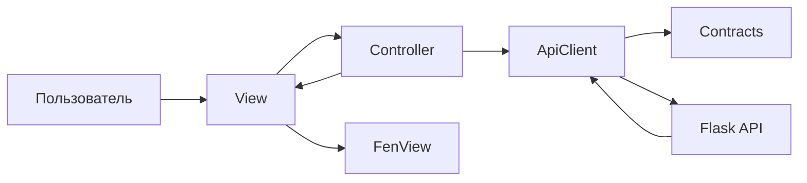
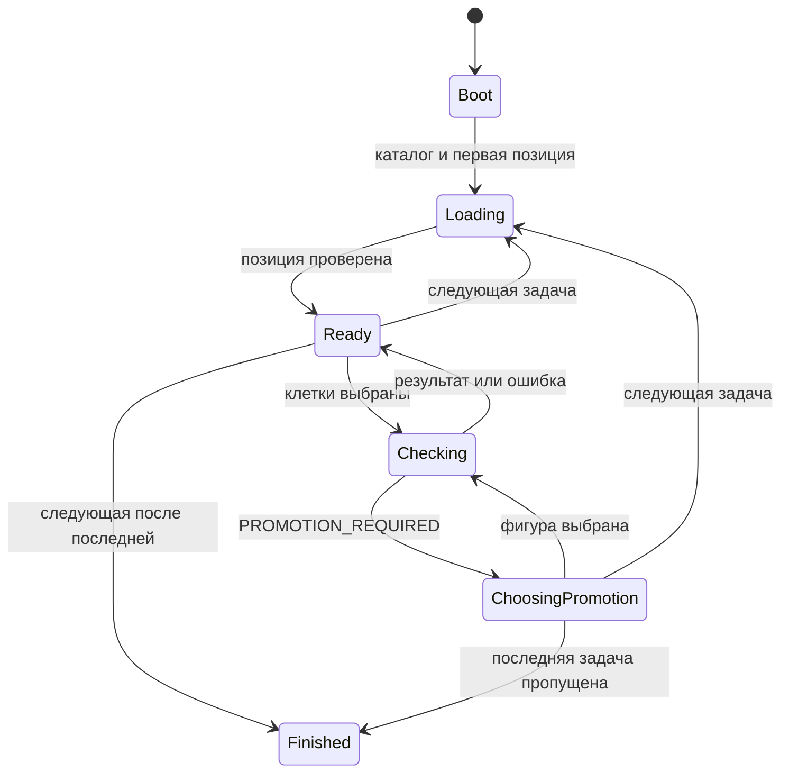
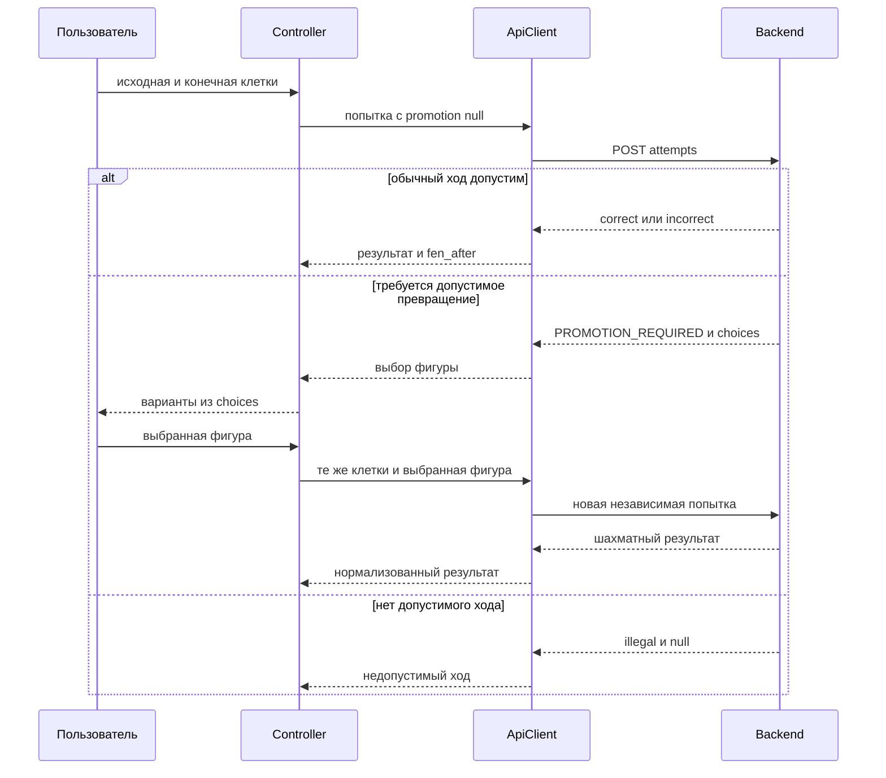

# Технический дизайн: mate-in-one-ui

## Обзор
Статус: дизайн подготовлен для проверки, НЕ УТВЕРЖДЁН. Требования утверждены пользователем 28 октября 2026 года; это зафиксировано в spec.json. Статус в тексте ранее подготовленных требований является историческим и этим этапом не переписывается.

Основания: [требования UI](requirements.md), [общий контракт API](../../contracts/mate-in-one-api.md), [журнал исследования](research.md). При расхождении форматов применяется утверждённый контракт. Этот дизайн не меняет его.

Пользователь получает задачу, выбирает один ход, получает серверный результат и переходит дальше. Создаётся небольшая страница без клиентской шахматной логики. В этом этапе создаются только документы; все перечисленные ниже исходники и тесты являются планом будущей реализации.

### Цели
Покрыть все 44 критерия 1.1–6.3; сохранить независимость попыток, явный выбор превращения, безопасные повторы и устойчивое отображение при ошибках.

### Не-цели
Шахматный движок, проверка допустимости и мата, определение необходимости превращения, подсказки ходов, партия, авторизация, база данных, сохранение прогресса, генерация задач и изменение backend.

## Boundary Commitments

### This Spec Owns
- HTML/CSS/JavaScript страницы и её временное состояние: каталог, текущий индекс, исходная и отображаемая позиции, выбор, ожидание, сообщение и операция повтора.
- Преобразование FEN в представление доски без вычисления шахматных правил.
- Клиентскую сторону обмена по существующему контракту, проверку формы ответов и привязку ответа к конкретному запросу.
- Только frontend-файлы и его проверки из File Structure Plan. Контракт остаётся внешним нормативным документом.

### Out of Boundary
- Python/Flask-приложение, маршруты API, проверка набора, python-chess, выбор пяти позиций и серверная оценка.
- Раздача UI средствами Flask: это интеграционное обязательство backend, а не совместное редактирование Python-файлов.
- Изменение контрактных схем, before-agreement, документов backend и серверной обработки ошибок.
- Никаких локальных списков допустимых ходов, предсказания превращения и вычисления позиции после хода.

### Allowed Dependencies
- Утверждённый API /api/v1 через тот же origin; DOM, CSS Grid, ES modules, Fetch, AbortController, таймеры браузера.
- Зависимости внутри UI идут от Controller к ApiClient и View; ApiClient к Contracts; View к FenView. Contracts и FenView не зависят от DOM, Controller или сети. Ссылки на JSDoc-типы Contracts разрешены во всех JS-модулях без обратного runtime-импорта.
- Нет npm-зависимостей приложения, CDN, библиотеки доски или шахматной библиотеки. Node.js используется только для будущих модульных проверок.

### Revalidation Triggers
Изменение API, FEN, схем ошибок, времени ожидания, происхождения запросов, расположения frontend или правил навигации требует повторной проверки UI/backend. Добавление сохранения прогресса, шахматной проверки либо подсказок требует пересмотра требований. Изменение формы состояния или направления импортов требует повторной проверки трассировки и гонок ответов.

## Архитектура

### Исходное состояние
Проверен корень и скрытые файлы проекта: исходников приложения и существующего UI-дизайна нет. Имеются две спецификации и общий контракт. Core steering отсутствует; используются требования, контракт и локальные правила cc-sdd, без выдуманных стандартов проекта.

### Паттерн и карта границ
Модульный JavaScript с одним Controller состояния; представление не выполняет запросы. Отдельного универсального store, event bus, репозитория или адаптерного слоя нет.

Стрелки на диаграмме обозначают взаимодействия; обратные действия View передаются callback-функциями. Правило импортов: app.js импортирует api.js и view.js; api.js импортирует contracts.js; view.js импортирует fen.js. Обратных импортов и циклов нет. HTML загружает только app.js как модуль; CSS не зависит от JS-модулей.

### Стек
| Участок | Выбор и версия | Роль |
| --- | --- | --- |
| Разметка | HTML Living Standard, нативные кнопки | Семантическая страница и клетки |
| Оформление | CSS Grid и aspect-ratio | Доска 8×8 и адаптация размеров |
| Логика | JavaScript ES modules, JSDoc | Явные типы данных и состояния |
| Сеть | Fetch и AbortController браузера | Запрос, чтение тела, тайм-аут |
| Сервер | Существующее обязательство Flask, версию выбирает backend | Один origin и API |
| Проверки | Node.js с node:test; браузерный стенд без сторонних библиотек | Будущие unit и UI-проверки |

Новые сторонние пакеты не выбираются, лицензии и миграции дополнительных runtime-зависимостей не возникают. Клиент рассчитан на актуальный браузер с ES modules, Fetch, AbortController, CSS Grid и aspect-ratio; фактические целевые Chrome/Edge проверяются при реализации, поддержку старых браузеров этот дизайн не обещает.

## File Structure Plan

Все пути относительны корню hw. Они зарезервированы как предлагаемый будущий frontend-каталог; физически сейчас не создаются.

### Структура и ответственность
| Путь — создать в будущем | Компонент | Единственная ответственность |
| --- | --- | --- |
| frontend/index.html | HTML | Семантическая структура страницы и подключение ресурсов |
| frontend/styles.css | CSS | Доска, выделение, состояния элементов и адаптация ширины |
| frontend/js/app.js | Controller | Инициализация и переходы единственного состояния |
| frontend/js/api.js | ApiClient | HTTP, deadline, нормализация сетевых результатов |
| frontend/js/contracts.js | Contracts | JSDoc-типы и проверка форм ответов контракта |
| frontend/js/fen.js | FenView | Синтаксический разбор FEN для отображения |
| frontend/js/view.js | View | DOM доски, сообщений, кнопок и выбора превращения |
| frontend/package.json | Метаданные проверок | private и type: module, без runtime-зависимостей |
| frontend/tests/contracts-fen.test.mjs | Проверки Contracts и FenView | Формы данных и соответствие координат |
| frontend/tests/api.test.mjs | Проверки ApiClient | HTTP, чтение тела, timeout и повтор |
| frontend/tests/controller.test.mjs | Проверки Controller | Переходы и гонки с подставными API/View |
| frontend/tests/browser-tests.html | Браузерный стенд | Контейнер для проверки настоящего DOM |
| frontend/tests/browser-tests.js | Проверки View и UI | Мышь, касание, текст, блокировки, размеры |
| frontend/tests/fixtures.js | Фикстуры проверок | Контрактные ответы и позиции без вычисления решений |

### Изменяемые файлы
При будущей UI-реализации существующие Python-файлы, контракт и документы backend не изменяются. В текущем этапе допустимы только design.md, research.md и spec.json этой спецификации. Необходимую настройку Flask выполняет backend-команда в своей границе до совместного интеграционного прогона.

## Системные потоки

### Состояние интерфейса
Состояние имеет phase: boot, loading, ready, checking, choosingPromotion или finished. Сетевой сбой не уничтожает состояние: error и retryOperation — отдельные поля поверх стабильного состояния. После ошибочного запроса UI возвращается в исходную стабильную phase, например ready или choosingPromotion; после ошибки загрузки каталога остаётся boot с доступным повтором.

Отказ загрузки возвращает предыдущую стабильную фазу с ошибкой; таблица переходов ниже уточняет диаграмму. Состояние solved блокирует доску в ready, но не переход. Пока выбора превращения ожидают без сетевого запроса, доска заблокирована, доступны четыре варианта и переход к следующей задаче; это сохраняет разрешённый пропуск. Переход очищает pendingAttempt и варианты. Из finished запросы и попытки не выполняются; перезагрузка страницы начинает новый просмотр без сохранённого прогресса.

### Превращение и обычный ход

Ветвление шахматной проверки выполняет исключительно backend. UI не выводит illegal из отсутствия превращения. Во время checking первоначальная доска не меняется; оптимистического перемещения нет.

### Ключевые переходы
| Событие | Обновление и инвариант |
| --- | --- |
| Каталог успешно получен | Сохранить порядок и загрузить первый ID; это два отдельных запроса с собственными deadline |
| Позиция загружена | Проверить ID и FEN, затем атомарно заменить currentIndex/currentTask, очистить solved, selection, pendingAttempt и результат |
| Выбор своей или чужой фигуры | Выбрать занятую клетку без проверки цвета; второе нажатие на исходную отменяет выбор |
| Другая клетка после выбора | Отправить from/to с null, даже если клетка занята |
| correct | Разобрать серверный fen_after; показать его, solved=true, сбросить выбор |
| incorrect или illegal | displayFen=initialFen, solved=false, сбросить выбор, разрешить новую попытку |
| Следующая задача | Вычислить currentIndex+1 по длине каталога; сохранить targetIndex до ответа; прежний экран оставить до успеха |
| Последняя и Next | Без HTTP перейти в finished; показать только окончание просмотра |
| Ошибка либо timeout | Сохранить исходную задачу и цель запроса, снять busy; error/retryOperation зависят от категории |
| Ручной повтор | Новый requestId, неизменные метод/ID/тело; после ошибки уточнённого превращения сохранена выбранная фигура |

Подпись стороны задания берётся из исходного FEN; успешный fen_after меняет отображаемую доску, не переопределяя исходную задачу. Результат старой попытки очищается при начале новой попытки, чтобы не выглядеть результатом текущей проверки. После ошибки позиции сообщение предыдущей задачи остаётся её собственным, а ошибка загрузки выводится отдельно.

## Трассировка требований
Канонический ID N.M образован заголовком N и номером критерия M в утверждённых requirements.md. Все 44 ID перечислены явно.

| Требование | Назначение | Компоненты | Интерфейс | Поток |
| --- | --- | --- | --- | --- |
| 1.1 | Первый каталог и первая позиция | Controller, ApiClient, Contracts, FenView, View | State и API | загрузка |
| 1.2 | Состояние загрузки | Controller, ApiClient, Contracts, FenView, View | State и API | загрузка |
| 1.3 | Доска, ID и сторона хода | Controller, ApiClient, Contracts, FenView, View | State и API | загрузка |
| 1.4 | Ориентация и координаты | Controller, ApiClient, Contracts, FenView, View | State и API | загрузка |
| 1.5 | Нет отправки без позиции | Controller, ApiClient, Contracts, FenView, View | State и API | загрузка |
| 2.1 | Выбор фигуры | Controller, ApiClient, View | State и API | попытка и превращение |
| 2.2 | Отмена выбора | Controller, ApiClient, View | State и API | попытка и превращение |
| 2.3 | Пустая клетка без выбора | Controller, ApiClient, View | State и API | попытка и превращение |
| 2.4 | Одна начальная попытка | Controller, ApiClient, View | State и API | попытка и превращение |
| 2.5 | Блокировка во время запроса | Controller, ApiClient, View | State и API | попытка и превращение |
| 2.6 | Выбор из choices | Controller, ApiClient, View | State и API | попытка и превращение |
| 2.7 | Нет общего повтора и автовыбора | Controller, ApiClient, View | State и API | попытка и превращение |
| 2.8 | Уточнённая попытка | Controller, ApiClient, View | State и API | попытка и превращение |
| 2.9 | Обычный ход с null | Controller, ApiClient, View | State и API | попытка и превращение |
| 2.10 | Нет локальной шахматной проверки | Controller, ApiClient, View | State и API | попытка и превращение |
| 3.1 | Успех и fen_after | Controller, FenView, View | State и API | результат |
| 3.2 | Блокировка после успеха | Controller, FenView, View | State и API | результат |
| 3.3 | Неуспех и исходная доска | Controller, FenView, View | State и API | результат |
| 3.4 | Недопустимость и исходная доска | Controller, FenView, View | State и API | результат |
| 3.5 | Новая попытка | Controller, FenView, View | State и API | результат |
| 3.6 | Нет преждевременного успеха | Controller, FenView, View | State и API | результат |
| 3.7 | Результат доступен текстом | Controller, FenView, View | State и API | результат |
| 4.1 | Следующий ID и пропуск | Controller, ApiClient, View | State и API | навигация |
| 4.2 | Атомарная смена задачи | Controller, ApiClient, View | State и API | навигация |
| 4.3 | Сохранение цели после ошибки | Controller, ApiClient, View | State и API | навигация |
| 4.4 | Последняя задача решаема | Controller, ApiClient, View | State и API | навигация |
| 4.5 | Явное окончание без запроса | Controller, ApiClient, View | State и API | навигация |
| 4.6 | Окончание не равно всем решениям | Controller, ApiClient, View | State и API | навигация |
| 4.7 | Навигация по длине каталога | Controller, ApiClient, View | State и API | навигация |
| 4.8 | 404 не означает окончание | Controller, ApiClient, View | State и API | навигация |
| 5.1 | Сбой и ручной повтор | Controller, ApiClient, Contracts, View | State и API | ошибки и представление |
| 5.2 | Полный ответ за 10 секунд | Controller, ApiClient, Contracts, View | State и API | ошибки и представление |
| 5.3 | Повтор метода и тела | Controller, ApiClient, Contracts, View | State и API | ошибки и представление |
| 5.4 | Повтор того же следующего ID | Controller, ApiClient, Contracts, View | State и API | ошибки и представление |
| 5.5 | Классификация по code | Controller, ApiClient, Contracts, View | State и API | ошибки и представление |
| 5.6 | 4xx требуют исправления | Controller, ApiClient, Contracts, View | State и API | ошибки и представление |
| 5.7 | Ошибка обмена | Controller, ApiClient, Contracts, View | State и API | ошибки и представление |
| 5.8 | Запоздавшие ответы | Controller, ApiClient, Contracts, View | State и API | ошибки и представление |
| 5.9 | Снятие временной блокировки | Controller, ApiClient, Contracts, View | State и API | ошибки и представление |
| 5.10 | Ошибка не шахматный результат | Controller, ApiClient, Contracts, View | State и API | ошибки и представление |
| 5.11 | Только ручные повторы | Controller, ApiClient, Contracts, View | State и API | ошибки и представление |
| 6.1 | Без учётной записи | View, HTML, CSS | DOM | ошибки и представление |
| 6.2 | Мышь и касание | View, HTML, CSS | DOM | ошибки и представление |
| 6.3 | Размеры 360 и 1280 | View, HTML, CSS | DOM | ошибки и представление |

## Компоненты и интерфейсы

| Компонент | Назначение | Покрытие | Зависимости | Контракты |
| --- | --- | --- | --- | --- |
| Controller | Состояние и действия | 1–5 | ApiClient P0; View P0 | Service, State |
| ApiClient | Запросы и транспортные исходы | 1, 2, 4, 5 | Fetch P0; Contracts P0 | Service, API |
| Contracts | Проверка границы JSON | 1.5, 5.5, 5.6, 5.7 | Общий контракт P0 | Service |
| FenView | Только представление FEN | 1.3, 1.4, 3.1, 3.3, 3.4 | Формат FEN P0 | Service |
| View | Представление и пользовательские события | 1–6 | FenView P0; HTML/CSS P0 | Service, Event |

HTML/CSS не вводят отдельного сервиса: native button на каждой клетке, читаемый выбранный контур, блокировки через disabled, отдельный блок сообщения и встроенная панель выбора превращения. Фигуры — фиксированное Unicode-соответствие буквам FEN; название фигуры и клетки присутствует в aria-label. Проверка видимости обоих цветов на светлых и тёмных клетках обязательна.

### Controller
Входящие зависимости: View actions — P0. Исходящие: ApiClient и View — P0. Контракты Service и State.

Публичные сигнатуры (описание для будущего JavaScript с JSDoc, не реализация):
- createController(api: ApiPort, view: ViewPort): ControllerPort.
- ControllerPort.start(): Promise<void>.
- ControllerPort.selectSquare(square: Square): Promise<void>.
- ControllerPort.choosePromotion(piece: PromotionPiece): Promise<void>.
- ControllerPort.next(): Promise<void>.
- ControllerPort.retry(): Promise<void>.
- ControllerPort.dispose(): void.

Controller владеет единственным AppState. View получает неизменяемый снимок; callbacks переводят действия обратно Controller. Каждое публичное действие проверяет текущую phase: disabled в DOM не является единственным барьером дубликатов.

Инварианты: currentIndex и currentTask меняются только вместе после успешной позиции; initialFen не изменяется; ID ответа совпадает с целью; один активный запрос; solved и finished сильнее временной разблокировки. Следующая попытка никогда не использует displayFen как исходный FEN.

### ApiClient
Входящая зависимость: Controller — P0. Исходящие: Contracts — P0. Внешние: Fetch, AbortController и таймеры — P0. Контракты Service и API.

Сигнатуры:
- createApiClient(fetchFn: FetchLike, clock: ClockPort): ApiPort.
- ApiPort.execute(operation: Operation, context: RequestContext): Promise<ApiOutcome>.
- ApiPort.cancel(requestId: number): void.

Operation — неизменяемое описание метода, вида catalog/task/attempt, taskId и точного тела при POST. RequestContext содержит локальные requestId и taskEpoch; ApiClient добавляет внутренний deadline по своему ClockPort. Общий префикс /api/v1 фиксирован; ID кодируется как значение сегмента URL, без конкатенации непроверенного пути. Не вводятся новые ограничения допустимых ID сверх контракта.

| Метод | Путь | Запрос | Успех |
| --- | --- | --- | --- |
| GET | /api/v1/tasks | Без тела | 200, tasks из пяти уникальных непустых ID |
| GET | /api/v1/tasks/{task_id} | Без тела | 200, id и fen |
| POST | /api/v1/tasks/{task_id}/attempts | application/json, ровно from/to/promotion | 200, task_id/result/fen_after |

Успешный статус — именно 200 согласно контракту. Параметры Fetch: credentials omit, cache no-store, redirect error; запросы остаются в одном origin. Непредусмотренный redirect считается ошибкой обмена/транспорта, а не переходом к другому серверу.

Deadline начинается до Fetch, таймер 10000 мс сохраняется до полного чтения тела и проверки формы; получение заголовков не завершает ожидание. По timeout вызывается abort и немедленно возвращается timeout; работа получает признак завершения, чтобы поздний успех либо catch не изменили её исход. Таймер очищается в каждом терминальном пути. После чтения и проверки проверяется deadline, чтобы ответ на границе срока не превратился в поздний успех. Это браузерное ограничение ожидания, а не SLA backend.

HTTP-ошибка не считается сетевым исключением: тело читается и проверяется, чтобы 400 PROMOTION_REQUIRED сохранил choices. При 5xx без JSON категория остаётся retryable server; при HTML/повреждённом JSON в 200 — protocol. При остальных 4xx с некорректной формой JSON возникает protocolError с ручным повтором согласно 5.7; корректно оформленные ошибки 4xx требуют исправления обращения. PROMOTION_REQUIRED распознаётся только по валидной паре HTTP 400 и code.

### Contracts и FenView
Contracts: validateCatalog(value: unknown), validateTask(value: unknown, expectedId: string), validateAttempt(value: unknown, expectedId: string), validateError(value: unknown, status: number) возвращают типизированный ValidationResult. Проверяются обязательные и лишние поля, типы, уникальность ID, соответствие HTTP/code, choices и nullable fen_after. Внешние значения остаются unknown до проверки; JSDoc задаёт объединения, приведения без проверок не допускаются.

FenView: parseFenForDisplay(fen: string): ValidationResult<BoardView>. Входящая зависимость View — P0; внешняя спецификация FEN из контракта — P0. Проверяются шесть полей, восемь рядов по восемь клеток, известные символы фигур, сторона w/b и синтаксическая структура остальных полей. Поля специальных прав сохраняются как данные, но не применяются. Не проверяются шах, допустимость позиции, права на конкретный ход или число матующих ходов.

BoardView содержит 64 клетки с координатами, фигурами и текстовыми названиями. Порядок — a8…h8 до a1…h1. При correct View разбирает fen_after прежде, чем Controller фиксирует solved; ошибка представления превращается в protocol error без частичного применения успеха. Для этого ViewPort.preparePosition(fen) возвращает ValidationResult<BoardView>, а render принимает уже подготовленные клетки; Controller не импортирует FenView.

### View
Вход: ViewPort.preparePosition(fen: string), ViewPort.render(snapshot: ViewState): void, ViewPort.bind(actions: UiActions): void. Исходящие события: selectSquare, choosePromotion, next и retry. События передаются ровно один раз; обработчики не накапливаются при повторном render. render не выполняет сеть и не оценивает ход.

ViewState содержит board, taskId, sideToMove, selectedSquare, resultMessage, errorMessage, busy, solved, finished, promotionChoices, canNext и canRetry. Управление текстом через textContent; фигуры выбираются из фиксированной таблицы. ID и сообщения сервера не интерпретируются как HTML.

Клетки — кнопки в CSS Grid с восемью равными колонками; ширина доски ограничена доступной шириной и сохраняет квадратную форму. На ширине 360px боковые отступы учитываются в общей ширине. Кнопки и панель превращения переносятся по строкам, сообщения не перекрывают доску. Нативный click обслуживает мышь и касание без отдельной логики drag-and-drop. Доступность с клавиатуры обеспечивается нативными кнопками; обновления сообщения объявляются через aria-live.

## Модели данных

### Логическая модель и типы
Все типы описываются JSDoc в contracts.js; приложение остаётся JavaScript.
- Square: строка формата a1–h8; PromotionPiece: q/r/b/n; Promotion: PromotionPiece либо null.
- Task: непустой id, исходный fen. AttemptBody: ровно from, to, promotion.
- AttemptResult: объединение correct/incorrect с непустым fen_after и illegal с fen_after=null; task_id обязателен.
- ApiError: code из контракта, непустой message, details: пустой объект либо точный choices для PROMOTION_REQUIRED.
- ApiOutcome: catalog, task, result, promotionRequired, clientError, serverError, networkError, timeout, protocolError или cancelled; каждый вариант имеет собственный discriminant и локальные requestId/taskEpoch для проверки актуальности.
- AppState: phase, catalog, currentIndex, currentTask, initialFen, displayFen, preparedBoard, selectedSquare, result, solved, pendingAttempt, promotionChoices, activeRequest, taskEpoch, error, retryOperation.
- RequestContext: монотонный requestId и taskEpoch; TransportContext дополнительно содержит deadline, созданный ApiClient. activeRequest дополнительно содержит Operation и resumePhase для возврата после сбоя. Operation сохраняет method, kind, taskId и неизменяемое тело. ID запроса не передаётся в API и не является ключом идемпотентности.
- ValidationResult<T>: размеченное объединение ok=true с value:T либо ok=false с reason:string. validateCatalog возвращает ValidationResult<Catalog>; validateTask — ValidationResult<Task>; validateAttempt — ValidationResult<AttemptResult>; validateError — ValidationResult<ApiError>.
- ClockPort: now():number, setTimeout(callback:()=>void, delayMs:number):TimerHandle, clearTimeout(handle:TimerHandle):void; now использует монотонное performance.now. FetchLike принимает URL:string и RequestInit и возвращает Promise<Response>. Это точки подстановки в тестах, без самостоятельного production-адаптера.
- catalog изначально пуст; currentIndex и currentTask равны null до первой позиции. selectedSquare, pendingAttempt, activeRequest, error и retryOperation допускают null; наличие задач определяется phase и текущей валидной позицией, а не DOM.

Объект ApiOutcome с result не смешивается с ошибкой. В finished нет активной операции. Данные существуют только в памяти страницы: нет localStorage, cookies и истории. Навигация использует catalog.length; отдельная проверка контрактной формы требует ровно пять элементов, не подменяя ею алгоритм перехода.

### Целостность и конкуренция
Controller присваивает новый requestId каждому запуску, включая повтор той же задачи. Перед записью любого ответа, ошибки и finally проверяются requestId, taskEpoch и активность операции. На timeout старый requestId инвалидируется до разблокировки. Новое действие инвалидирует прежний retryOperation; повтор не может отправить запрос старой задачи после смены экрана.

Подготавливаемая следующая позиция хранится отдельно от текущей до валидации и разбора FEN. После сетевого сбоя обновлённое тело не создаётся заново из mutable selection: повтор использует сохранённый снимок. При PROMOTION_REQUIRED создаётся новое тело с выбранной фигурой, что не является повтором прежнего тела.

## Обработка ошибок
Категории UI и сообщения не меняют контракт backend.

| Исход | Действие UI | Повтор |
| --- | --- | --- |
| 200 correct/incorrect/illegal | Обработать результат из раздела потоков | Новая попытка только при неуспехе |
| 400 PROMOTION_REQUIRED | Встроенный выбор только из details.choices | Уточнённая попытка, не обычный Repeat |
| Остальные 400; 404; 405; 415 | Понятная ошибка обращения по code | После исправления, без автоматического повтора |
| 500/503 и другие инфраструктурные 5xx | Ошибка сервера, сохранить позицию | Ручной тот же запрос |
| Network или timeout | Сообщение о соединении либо сроке | Ручной тот же запрос |
| Некорректный 200, неизвестный result, неверный ID/FEN | Ошибка обмена без применения ответа | Ручной тот же запрос |
| cancelled или устаревший запрос | Не менять состояние | Не показывать самостоятельный результат |

Для корректно оформленных 4xx пользователь может выбрать новую попытку либо перейти к следующей задаче, если текущая позиция доступна; UI не предлагает бесполезный повтор неизменённого некорректного тела. Непредусмотренный статус, неверный envelope или неизвестный code в 4xx относится к protocolError и позволяет ручной повтор согласно 5.7; это отделено от распознанной ошибки обращения. Неожиданный формат успешного ответа всегда оставляет возможность ручного повтора согласно 5.7. После ошибки первоначальной загрузки доступен соответствующий повтор; доска без задачи заблокирована.

Смежный серверный приоритет: маршрут/метод → набор → ID → Content-Type → JSON → структура/типы → формат → шахматная оценка. Набор недоступен для определения ID: 503; доступен, но ID отсутствует: 404 до проверки тела. UI не воспроизводит этот порядок локально и не преобразует 404 в конец каталога.

Постоянная телеметрия и удалённый сервис логирования не вводятся. Для разработки достаточно Network браузера и локальной диагностики категории/HTTP/requestId без трассировок сервера, FEN-решений и полной истории действий.

## Стратегия проверок
Проверки перечислены для будущей реализации, сейчас не создаются и не выполняются.

### Модульные
- contracts-fen.test.mjs: формы каталога, пять уникальных ID, лишние поля, неизвестные code/result, несовпадающий ID; начальный и конечный FEN; a1/a8/h1/h8 и оба цвета. Основания 1.3, 1.4, 1.5, 3.1, 5.5, 5.7.
- api.test.mjs: HTTP 400 с валидным PROMOTION_REQUIRED не теряет choices; 200 correct/incorrect при null, 200 illegal с null; неправильная пара HTTP/code. Основания 2.6, 2.9, 3.1, 3.3, 3.4, 5.5, 5.6.
- api.test.mjs: fake clock — заголовки до 10 секунд и тело позже, timeout и единичное завершение; сеть и 5xx, сохранение точного тела уточнённого превращения. Основания 5.1, 5.2, 5.3, 5.10, 5.11.
- controller.test.mjs: прямой повторный вызов действий не создаёт дубликат; после correct доска заблокирована, Next доступна; при incorrect/illegal возвращается исходная доска. Основания 2.1–2.5, 3.1–3.7.
- controller.test.mjs: устаревший успех и устаревший finally после timeout не меняют новую попытку той же задачи и не снимают её busy; ошибочная загрузка Next повторяет тот же ID. Основания 4.2, 4.3, 5.4, 5.8, 5.9.

### Браузерные и интеграционные
- browser-tests.html с подставным Fetch: загрузка каталога и первой позиции, выбор/отмена/пустая клетка; реальный DOM, один запрос на действие. Основания 1.1–1.5, 2.1–2.5.
- Превращение: только серверный PROMOTION_REQUIRED открывает четыре кнопки из choices; null для обычного хода не открывает их; выбранная фигура уходит в следующем теле; ошибка последующего запроса повторяет выбранную фигуру. Основания 2.6–2.10, 5.3.
- Пропуск, последняя нерешённая задача и Next: переходы по каталогу, последняя не блокируется преждевременно, окончание не отправляет HTTP и не утверждает решение всех задач. Основания 4.1–4.8.
- Последовательность сетевого сбоя, HTML вместо JSON, 500, 503 и восстановления: состояние сохраняется, сообщения не становятся incorrect, ручной повтор работает без перезагрузки. Основания 5.1–5.11.
- Мышь/касание и ширины 360/1280: все фигуры, сообщения и кнопки доступны, нет горизонтальной прокрутки; native buttons, выбранный контур, русские подписи, отсутствие запроса учётных данных. Основания 3.7, 6.1–6.3.

Совместный прогон выполняется только после готовности backend: GET /, ресурсы с правильным MIME и API доступны с одного origin; реальный набор из пяти пригодных позиций. Контрактные негативные запросы отдельно подтверждают 503 до ID и 404 до повреждённого тела. Фикстуры UI не заменяют серверную проверку пригодности и не вычисляют шахматные решения.

### Производительность
Единственный согласованный численный предел — клиентское ожидание 10000 мс. Не вводятся цели RPS, SLA и неподтверждённые нормативы скорости. Чтение тела и проверки входят в окно ожидания; таймеры проверяются также с задержанным телом.

## Интеграция, готовность и риски
До совместного запуска backend должен отдать frontend/index.html на GET / и содержимое frontend под /static/ui; HTML ссылается на /static/ui/styles.css и /static/ui/js/app.js. Это конкретная точка подключения, а не изменение API. Backend настраивает Flask static_folder на frontend и static_url_path на /static/ui либо эквивалентную раздачу без перемещения UI-файлов. Модули получают JavaScript MIME, CSS — text/css. Вне разработки раздача frontend/tests и frontend/package.json исключается сервером или упаковкой ресурсов; публично доступны только index.html, styles.css и js. Отдельный тестовый маршрут приложения не вводится.

Миграция данных отсутствует. Последовательность будущих работ: чистые форматы/FEN и разметка → ApiClient → Controller/View → проверки → согласованная раздача Flask и совместный прогон. Мок-ответы позволяют разрабатывать UI до готовности backend. Эти шаги не являются созданным tasks.md или разрешением на реализацию.

Открытый вопрос состава пяти позиций остаётся у backend; он не блокирует документирование и проверку UI на фикстурах, но блокирует окончательный прогон на реальном наборе. Недостающие steering не восполняются предположениями. Изменение серверной структуры проекта требует только адаптации точки раздачи UI с повторной проверкой интеграции.

## Источники платформенных решений
- [MDN Fetch](https://developer.mozilla.org/en-US/docs/Web/API/Fetch_API/Using_Fetch): HTTP-статус и чтение тела проверяются отдельно.
- [MDN AbortController](https://developer.mozilla.org/en-US/docs/Web/API/AbortController/abort): отмена запроса и чтения тела.
- [MDN Modules](https://developer.mozilla.org/en-US/docs/Web/JavaScript/Guide/Modules): HTTP и JavaScript MIME для модулей.
- [Flask static files](https://flask.palletsprojects.com/en/stable/quickstart/#static-files): штатная раздача ресурсов.
- [Node.js test runner](https://nodejs.org/api/test.html): встроенные модульные проверки без пакетов.

## Проверка дизайна
Основной контекст, без делегирования: все 44 ID покрыты трассировкой; границы и направление импортов заданы; каждый внутренний компонент связан с файлом; состояние, ошибки, deadline и выбор превращения имеют явные контракты; планы проверок выведены из требований. Дизайн остаётся неутверждённым до отдельного решения пользователя. Исходники приложения и тестов сейчас не создаются.
